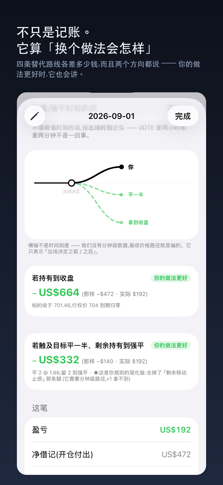
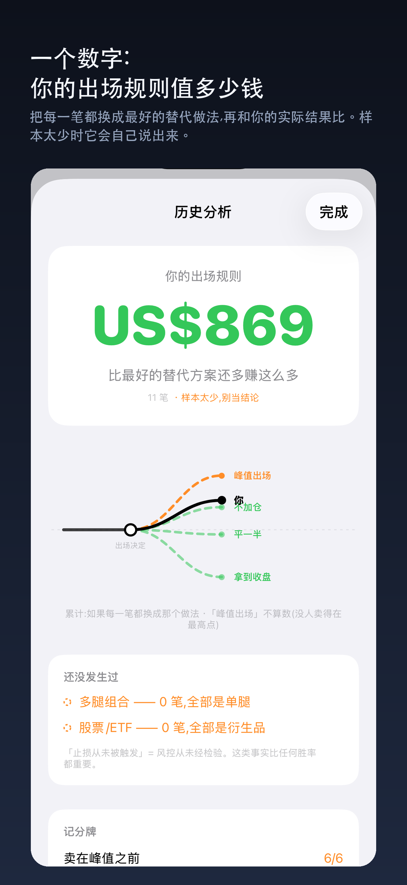
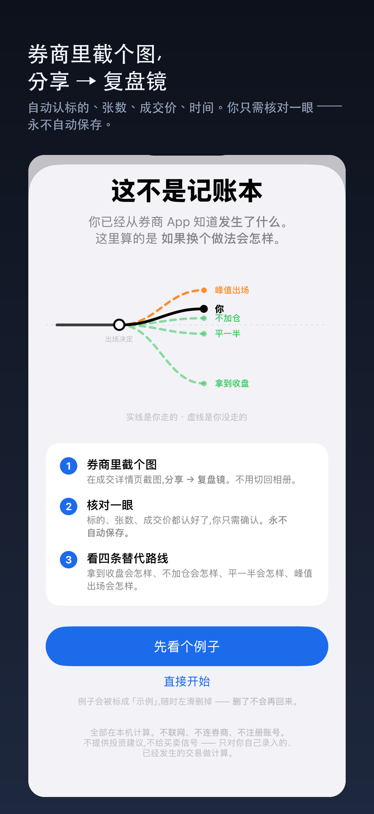
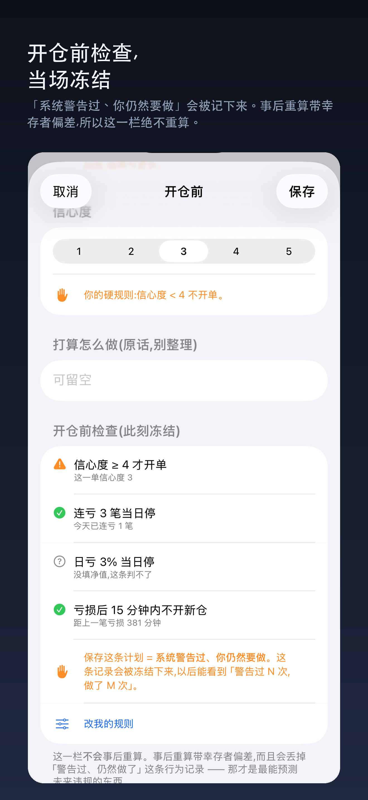

# TradeMirror

**A local-first iOS app that reviews your trades by asking: _what if you had done it differently?_**

Your brokerage app tells you what happened. TradeMirror works out what *would* have happened under alternative exits, and it does all of that on your phone.

Co-developed by **Chaejin (Celine) Lee** and **Rui Zhang**.

<p>
  
  
  
  
</p>

## What it does

- **Counterfactual review.** Each closed trade is replayed under 6 alternative exits: hold to close, exit at the underlying's peak, an N% trailing stop, scale out half and trail the rest, take half at target and hold the rest, and no add-ons. A fork chart draws the path you took (solid) against the paths you didn't (dashed). Options are repriced with **Black-Scholes**, using implied volatility solved from your own fill price.
- **Screenshot import with on-device OCR.** Pick brokerage fill screenshots and Apple **Vision** pulls out the symbol, side, open/close, call/put, strike, quantity, fill price and time. Every parse is cross-checked (quantity × price × multiplier = amount), and opening and closing fills are paired automatically.
- **Manual entry** for stocks/ETFs, options, futures and FX, with 13 multi-leg strategy templates (verticals, calendars, iron condors and more) and pre-save sanity checks.
- **Analytics.** Daily, weekly, monthly and yearly P&L scoreboards, a 14-week heatmap, and P&L distributions by entry time of day and holding time. Statistical checks show whether a difference between buckets is more than chance.
- **Kelly position sizing** for premium-paying option trades. A **4,000-run bootstrap** shows how reliable the estimate is, along with drawdown odds over the next 100 or 250 trades.
- **Trading rules and discipline.** "Circuit breakers" cover a confidence threshold, a stop after N consecutive losses, a cool-down after a loss and a daily loss cap. After each trade you self-check it against your own rulebook.
- **Local-first and private.** There are no accounts, no servers and no ads. The only network request fetches market data (one symbol and a date range). You also get lossless backup and restore, CSV export, daily auto-backup to a folder you choose (for example iCloud Drive), and a Chinese/English UI.

TradeMirror doesn't give investment advice or trading signals. It only does math on trades you've already made.

## Engineering

- **SwiftUI, iOS 17+.** The analytics engine (`Sources/ReviewEngine`, 41 files and about 6,900 lines) is a standalone Swift package that is fully separate from the UI (`App/`, 32 files and about 7,700 lines). Every decision lives in the engine; the views only render.
- **560+ automated tests** (`Tests/ReviewEngineTests`). Key figures are cross-validated against independent Python calculations, and real brokerage screenshots run through the actual Vision OCR pipeline (see [Test data privacy](#test-data-privacy)).
- Every bug fix is checked by deliberately reintroducing the bug and confirming that a test goes red.
- The Xcode project is generated by `gen_xcodeproj.py`, so `project.pbxproj` should not be edited by hand.

## Build and test

```bash
export DEVELOPER_DIR=/Applications/Xcode.app/Contents/Developer   # use full Xcode, not the Command Line Tools
swift test                                                         # engine test suite
python3 gen_xcodeproj.py                                           # (re)generate the Xcode project
xcodebuild -project TradeMirror.xcodeproj -scheme TradeMirror \
  -destination 'platform=iOS Simulator,name=iPhone 17' -derivedDataPath .build/xc build
```

To install on your own iPhone, put your Apple Team ID in a local `.developer_team` file (it is git-ignored), then run `./install_to_iphone.sh`.

## Test data privacy

The OCR fixture tests run on real brokerage screenshots, and those screenshots contain account details, so they are **not** included in this repository. Without them, `RealScreenshotFixtureTests` is skipped automatically and every other test runs as usual. See [`Tests/ReviewEngineTests/Fixtures/README.md`](Tests/ReviewEngineTests/Fixtures/README.md) to run that layer with your own screenshots.

## More docs

- [`README.zh-CN.md`](README.zh-CN.md) is the original design README (Chinese).
- [`DECISIONS.md`](DECISIONS.md) records the design decisions (Chinese).
